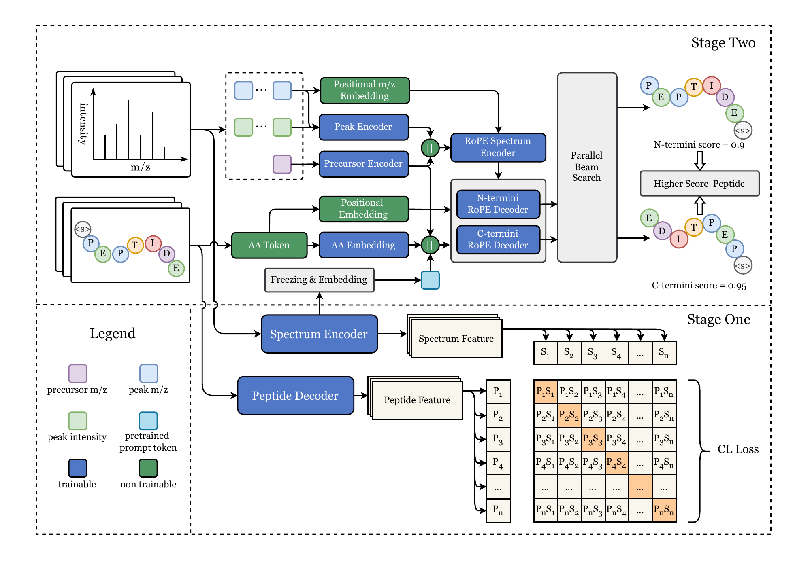

# RocNovo

Official implementation of **RocNovo: Bidirectional Peptide Sequencing with Contrastive Global Priors and Rotational m/z Embeddings** (IEEE BIBM 2026, B2354).

**Hongtao Xu, Peng Xiong, and Haoran Zheng** · University of Science and Technology of China

**Version: 1.0.0**

RocNovo predicts peptide sequences from tandem mass spectra using contrastive spectrum–peptide pretraining, continuous-m/z rotary position embeddings, and bidirectional autoregressive decoding.

## Model architecture



The original architecture diagram shows contrastive pretraining (Stage One) and prompt-guided bidirectional sequencing (Stage Two). See the [result figures](docs/results.md#visual-results) for benchmark comparisons and component analysis.

## Related repositories

| Repository | Link |
| --- | --- |
| Source code and benchmark summaries | [GitHub: lastmme/RocNovo](https://github.com/lastmme/RocNovo) |
| Pretrained models | [ModelScope: lastmme/RocNovo](https://modelscope.cn/models/lastmme/RocNovo) |
| Evaluation data and scripts | [ModelScope: lastmme/RocNovo-evaluation](https://modelscope.cn/datasets/lastmme/RocNovo-evaluation) |

Each repository provides its own usage instructions.

## Documentation and results

- [MGF to HDF5 conversion](docs/data_conversion.md)
- [Datasets and download organization](docs/datasets.md)
- [Pretrained checkpoints and paper mapping](docs/models.md)
- [Benchmark results and downloadable summaries](docs/results.md)
- [Evaluation commands and metric definitions](docs/evaluation.md)
- [Configuration, training modes, and DDP notes](docs/configuration.md)

### Benchmark overview

| Training / evaluation | AA Precision | Peptide Recall |
| --- | --- | --- |
| NovoBench Seven-species | 0.570 | 0.377 |
| NovoBench Nine-species | 0.821 | 0.640 |
| NovoBench HC-PT | 0.676 | 0.516 |
| MassIVE-KB / Nine-species V1 | 0.829 | 0.656 |
| MassIVE-KB / Nine-species V2 (filtered) | 0.924 | 0.803 |

Values are rounded fractions; V1/V2 averages are across species. Full species-level metrics, PTM results, ablations, and source files are available in the [results guide](docs/results.md).

## Installation

Use Linux with an NVIDIA GPU and a compatible CUDA/PyTorch environment for the GPU training and inference implementation. The distributed training code uses NCCL.

```bash
git clone https://github.com/lastmme/RocNovo.git
cd RocNovo
conda create -n rocnovo python=3.11
conda activate rocnovo
pip install -r requirements.txt
```

## Data

Use our [ModelScope test inputs](https://modelscope.cn/datasets/lastmme/RocNovo-evaluation), or convert your own MGF files:

```python
from rocnovo.data.prepare_data import MgfToHdf5
MgfToHdf5("example.mgf", "example.hdf5", ms_level=2, annotated=True)
```

Use `annotated=True` for training/evaluation and `False` for unannotated inference. The function copies `SEQ` strings without converting modification notation and overwrites an existing output. See the [conversion guide](docs/data_conversion.md) for accepted inputs, parameters, output fields, and alignment checks.

## Inference

Download the matching CLIP/de novo checkpoints and configuration pair. Set `clip_config_path`, `clip_checkpoint_path`, and `predictor_data.test_path` to your local files. Paths in YAML are resolved from the working directory. The released examples use beam size **10** and precursor tolerance **50 ppm**.

```bash
python -m rocnovo.rocnovo denovo predict --config path/to/denovo.yaml --checkpoint path/to/denovo.ckpt --output predictions.csv
```

Do not mix CLIP configurations or checkpoints between training settings. De novo checkpoints include the frozen CLIP model; the standalone CLIP checkpoint is also provided for Stage One use.

Prediction CSV columns:

```text
precursor_mz,precursor_charge,seq1_score,seq1,seq2_score,seq2,pred_mass,pred_score,pred_peptide,idx
```

`pred_peptide` is the selected directional output; `idx` is the original zero-based input sample index. The direction of `seq1` and `seq2` follows the peptide tokenizer configuration. Keep these indices when applying evaluation exclusions.

## Training

Set training/validation HDF5 paths and output directories in the matching YAML files.

```bash
python -m rocnovo.rocnovo clip train --config clip.yaml
python -m rocnovo.rocnovo denovo train --config denovo.yaml
```

Train Stage One first, then set the trained `clip_checkpoint_path` before Stage Two. Stage Two freezes the contrastive model and learns the generation modules. Set `trainer.load_mode` to `TFS` for a fresh run, `RESUME` to restore optimizer/scheduler state, or `WARM_START` to initialize model weights only. Preserve the checkpoint's architecture and tokenizer settings when loading it.

## Configuration and runtime notes

- Match checkpoint architecture/tokenizer settings and use dataset-specific YAML files.
- Set `trainer.load_mode` explicitly: `TFS`, `RESUME`, or `WARM_START`.
- `trainer.warmup_epochs` is an epoch duration, not a fraction of the total run.
- NCCL training requires a suitable Linux/CUDA setup. The default DDP port is `12355`; change it if occupied.
- Beam-search mass tolerance is specified in **ppm**.

See the [full configuration guide](docs/configuration.md) for the original configuration fields and runtime details.

## Evaluation

Evaluation instructions and scripts are provided in the ModelScope dataset repository. [Results and downloadable summaries](docs/results.md) are maintained here with the source code.

## License

Our original code, model weights, configurations, and documentation are released under [Apache-2.0](LICENSE). This does not relicense third-party code or benchmark data. See [license scope](LICENSE_SCOPE.md) for the distinction and source attribution.

## Citation and contact

Please cite our BIBM 2026 paper when using RocNovo:

> Hongtao Xu, Peng Xiong, and Haoran Zheng. RocNovo: Bidirectional Peptide Sequencing with Contrastive Global Priors and Rotational m/z Embeddings. IEEE BIBM, 2026.

Questions and reproducibility issues: https://github.com/lastmme/RocNovo/issues
