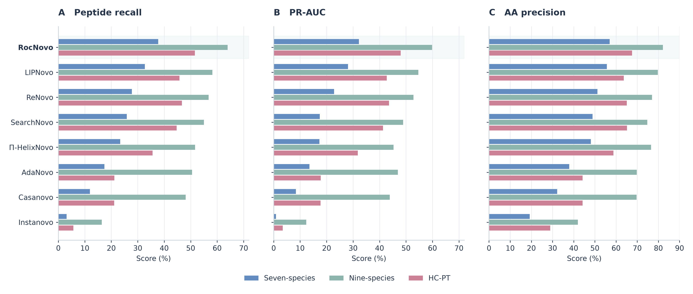
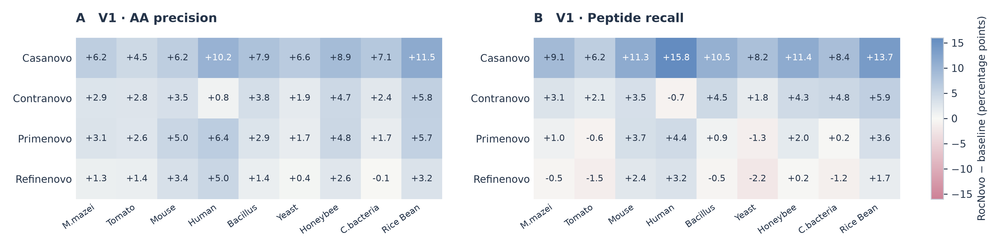
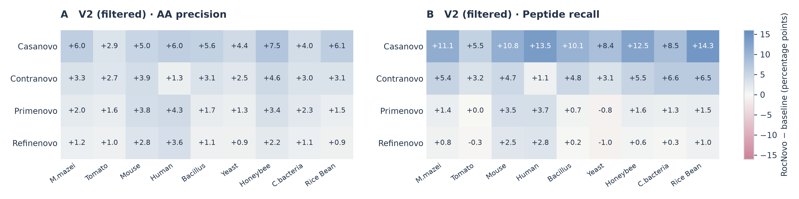
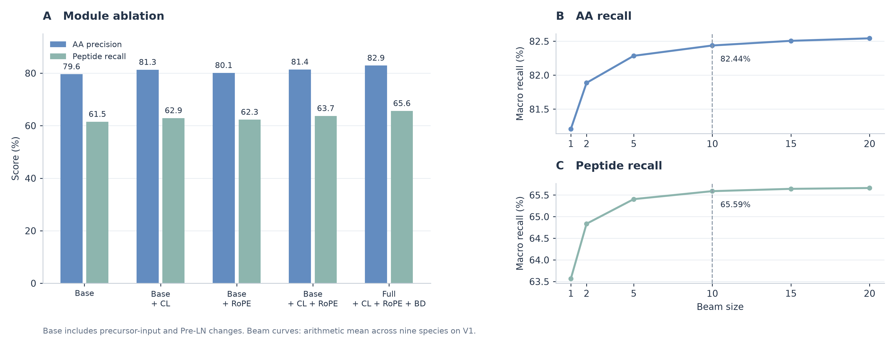
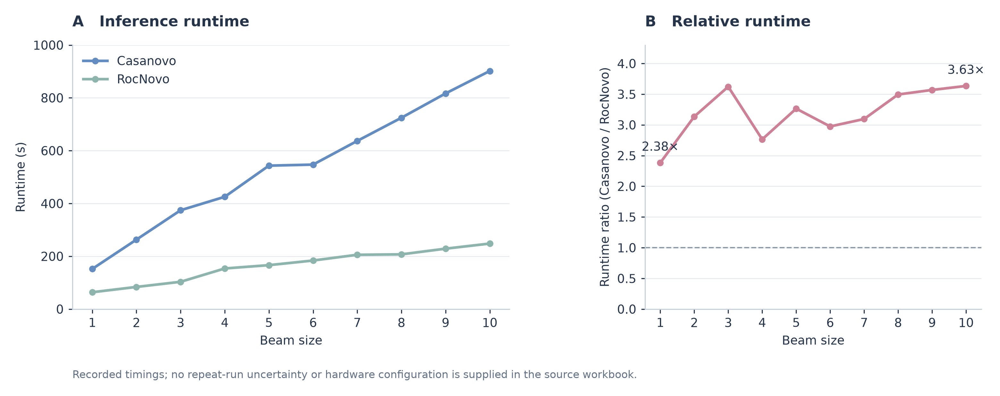

# Results

We provide the benchmark summaries accompanying RocNovo version 1.0.0. Values below are read from the downloadable CSV summaries; numbers are fractions rounded to three decimals. They are not generated from a new inference run. Original-precision values are available in the linked files.

## NovoBench

Each subset uses its corresponding NovoBench-trained model. See paper Tables I–II.

| Subset/species | AA Precision | AA Recall | Peptide Recall | PR-AUC | PTM Precision | PTM Recall |
| --- | --- | --- | --- | --- | --- | --- |
| hc_pt | 0.676 | 0.675 | 0.516 | 0.480 | 0.747 | 0.810 |
| nine_species | 0.821 | 0.821 | 0.640 | 0.599 | 0.792 | 0.729 |
| seven_species | 0.570 | 0.572 | 0.377 | 0.322 | 0.558 | 0.529 |

[Download metrics CSV](../results/novobench/metrics.csv)

## MassIVE-KB training: Nine-species V1

| Subset/species | AA Precision | AA Recall | Peptide Recall |
| --- | --- | --- | --- |
| M.mazei | 0.835 | 0.834 | 0.664 |
| Tomato | 0.843 | 0.838 | 0.694 |
| Mouse | 0.837 | 0.833 | 0.609 |
| Human | 0.795 | 0.793 | 0.618 |
| Bacillus | 0.878 | 0.877 | 0.733 |
| Yeast | 0.826 | 0.820 | 0.691 |
| Honeybee | 0.816 | 0.816 | 0.622 |
| C.bacteria | 0.751 | 0.744 | 0.534 |
| Rice Bean | 0.877 | 0.865 | 0.737 |

[Download full V1 metrics](../results/9-species-v1/metrics.csv)

## MassIVE-KB training: Nine-species V2

V2 values are evaluated after the supplied mass-mismatch exclusions. Inference is performed on the full input before filtering. See [data protocol](datasets.md).

| Subset/species | AA Precision | AA Recall | Peptide Recall |
| --- | --- | --- | --- |
| M.mazei | 0.940 | 0.939 | 0.840 |
| Tomato | 0.932 | 0.930 | 0.831 |
| Mouse | 0.892 | 0.888 | 0.680 |
| Human | 0.943 | 0.942 | 0.845 |
| Bacillus | 0.942 | 0.940 | 0.862 |
| Yeast | 0.952 | 0.951 | 0.888 |
| Honeybee | 0.909 | 0.907 | 0.778 |
| C.bacteria | 0.854 | 0.851 | 0.640 |
| Rice Bean | 0.950 | 0.949 | 0.863 |

[Download full filtered V2 metrics](../results/9-species-v2/metrics_filtered.csv)

## Across-species averages

Arithmetic macro-averages below are calculated from the original-precision species rows, not by averaging rounded table cells. AA Recall is provided by the result CSVs even though paper Table III reports only AA Precision and Peptide Recall.

| Subset/species | AA Precision | AA Recall | Peptide Recall |
| --- | --- | --- | --- |
| Nine-species V1 | 0.829 | 0.824 | 0.656 |
| Nine-species V2 (filtered) | 0.924 | 0.922 | 0.803 |

## Ablation study

All configurations use MassIVE-KB training and Nine-species V1 evaluation. The table follows the supplied ablation workbook (paper Table IV). Base includes precursor-input and Pre-LN changes; gains below are relative to that modified baseline.

| Configuration | AA Precision | AA Recall | Peptide Recall |
| --- | --- | --- | --- |
| Base | 0.796 | 0.794 | 0.615 |
| Base + CL | 0.813 | 0.810 | 0.629 |
| Base + RoPE | 0.801 | 0.797 | 0.623 |
| Base + CL + RoPE | 0.814 | 0.810 | 0.637 |
| Base + CL + RoPE + BD | 0.829 | 0.824 | 0.656 |

[Download ablation workbook](../results/ab-result/ablation_results.xlsx)

## Additional resources

| File | Contents |
| --- | --- |
| [Paper table workbook](../results/paper_results/paper_tables.xlsx) | Original worksheet names include benchmark, ablation, beam, timing, and dataset summaries |
| [Dataset overview](../results/dataset-overview/dataset_overview.xlsx) | Supplied dataset statistics |
| [Timing workbook](../results/speed-vs-casanovo/speed_vs_casanovo.xlsx) | Casanovo/RocNovo measurements under columns 1–10 |

Runtime is reported in seconds for beam sizes 1–10.

## Reproduce evaluation

Evaluation scripts and instructions are maintained in [our ModelScope dataset repository](https://modelscope.cn/datasets/lastmme/RocNovo-evaluation). This code repository provides the aggregate summaries and paper result tables.
