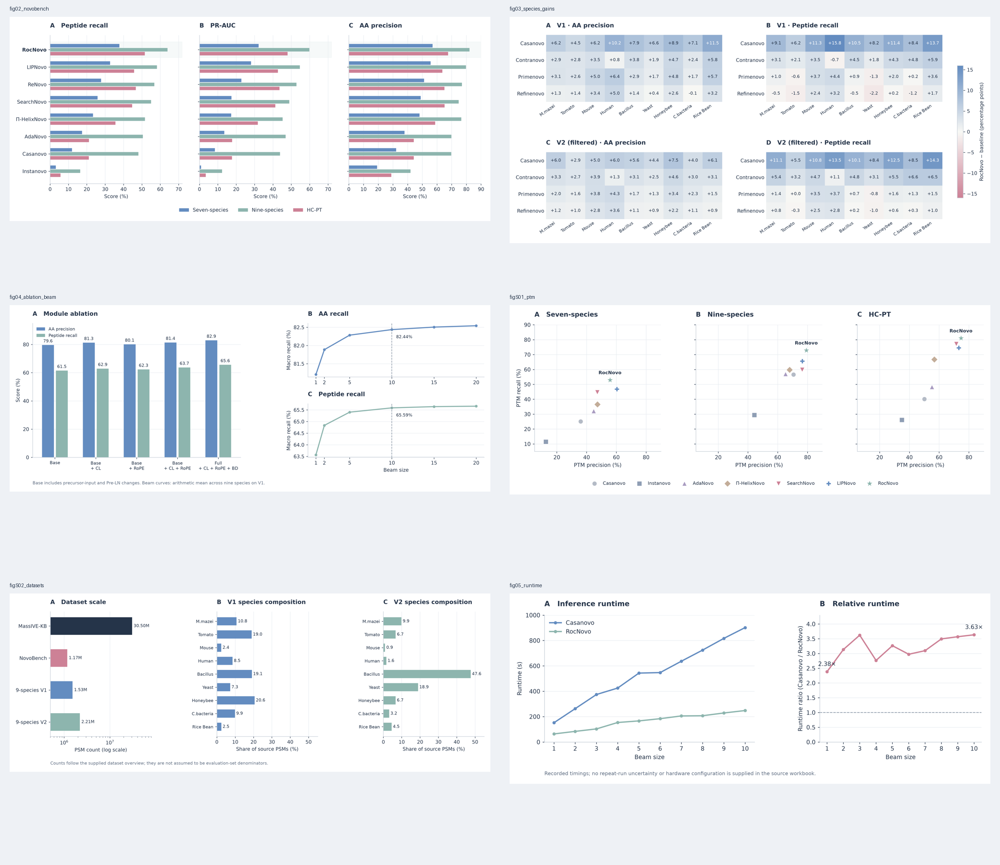

# Result figures

The six result figures use Scheme I: mist blue `#638CC0`, rose `#CD8196`, and soft teal `#8DB5AE`. Original workbooks and CSV summaries are unchanged.

| Figure | Content | Downloads |
| --- | --- | --- |
| Model architecture | Original author-supplied model diagram, without the later restyled alternatives | [PNG](model_architecture.png) |
| NovoBench | Eight methods on three subsets | [PDF](fig02_novobench.pdf), [SVG](fig02_novobench.svg), [PNG](fig02_novobench.png) |
| Species differences | RocNovo minus four baselines; AA precision and peptide recall | [PDF](fig03_species_gains.pdf), [SVG](fig03_species_gains.svg), [PNG](fig03_species_gains.png) |
| Ablation and beam | Discrete module configurations and macro-recall response | [PDF](fig04_ablation_beam.pdf), [SVG](fig04_ablation_beam.svg), [PNG](fig04_ablation_beam.png) |
| Runtime | Seconds at beam sizes 1–10 and recorded runtime ratios | [PDF](fig05_runtime.pdf), [SVG](fig05_runtime.svg), [PNG](fig05_runtime.png) |
| PTM | Precision/recall operating points | [PDF](figS01_ptm.pdf), [SVG](figS01_ptm.svg), [PNG](figS01_ptm.png) |
| Dataset overview | Source PSM counts and species proportions | [PDF](figS02_datasets.pdf), [SVG](figS02_datasets.svg), [PNG](figS02_datasets.png) |



## Reproduce

From the repository root, using Python 3.10 or later:

```bash
pip install -r results/figures/requirements.txt
python results/figures/generate_figures.py
```

The default palette is Scheme I. The script reads the existing workbooks under `results/` with the Python standard library and exports the six result figures as vector PDF, editable-text SVG, and 300 dpi PNG. It also writes the contact sheet and `sources.json`. The original model diagram is preserved as an author-supplied image and is not regenerated by this script.

## Sources and interpretation

- `sources.json` records source workbooks, sheets and cell ranges, relative to `results/`.
- Baseline comparisons, ablations and beam curves use `paper_results/paper_tables.xlsx`. The duplicate V2 rows in `Table2-9species-v1` supply the species differences; `Table3-9species-v2` also contains those V2 results.
- Dataset counts use `dataset-overview/dataset_overview.xlsx`.
- Runtime uses `speed-vs-casanovo/speed_vs_casanovo.xlsx`. The authors confirmed beam sizes 1–10 and seconds. Hardware, batch size, timing scope and repeat-run uncertainty are not documented in that workbook.
- Differences are percentage points. No confidence intervals or significance tests are inferred from aggregate data. Filtered V2 and V1 are separate evaluation settings.
- PTM points are not full PR curves. Dataset source counts are not assumed evaluation denominators.
